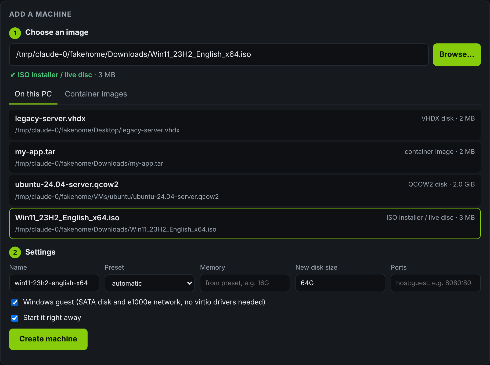
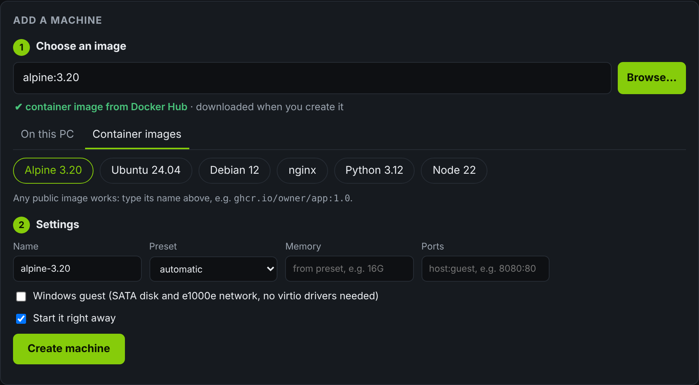
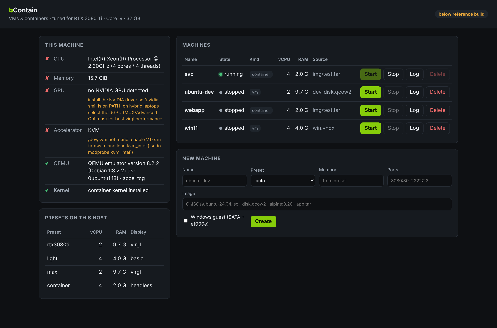
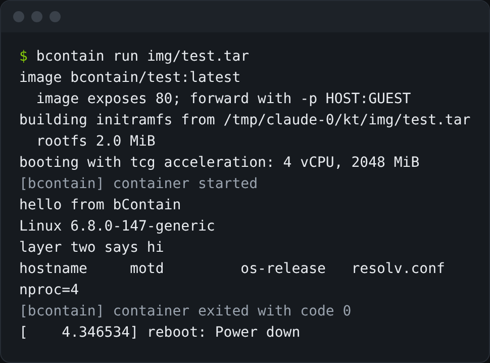
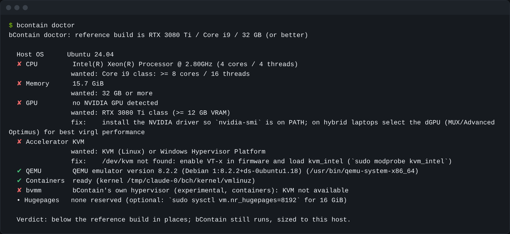
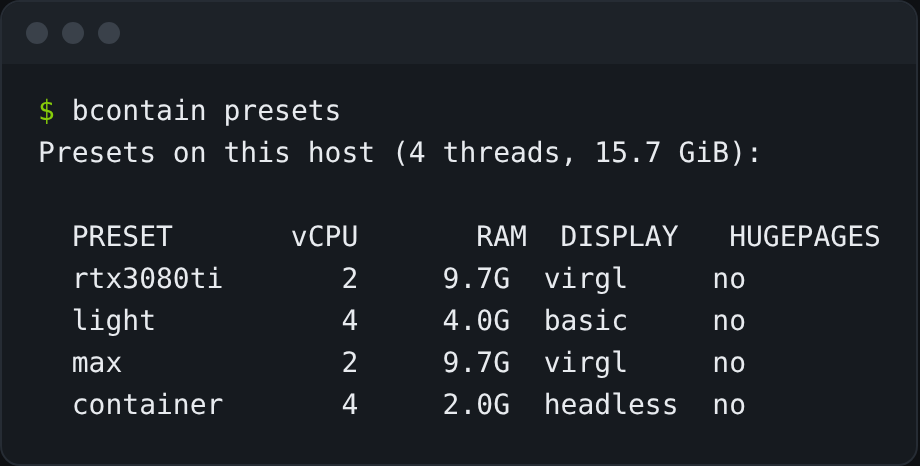
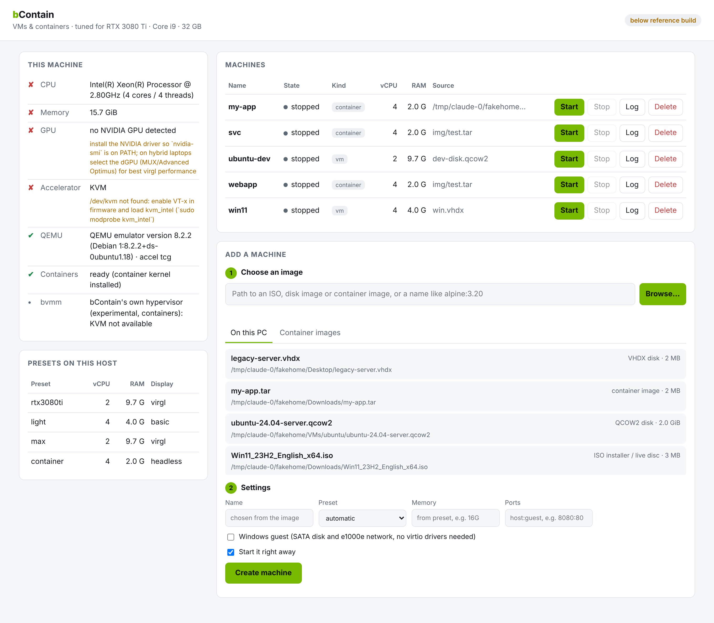
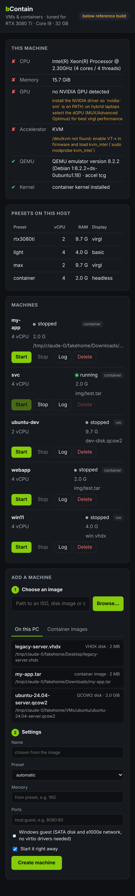

<!-- SPDX-FileCopyrightText: 2026 Bryant Frankford <nathanielfrankford@gmail.com> and Contributors -->
<!-- SPDX-License-Identifier: CC-BY-SA-4.0 -->
# bContain

A standalone runner for **virtual machines and containers** on **Windows and
Linux**. It is tuned for an **RTX 3080 Ti / Core i9 / 32 GB laptop, or better**.

- **Boots disk images:** ISO, qcow2, raw `.img`, VHDX, VHD, VMDK, VDI. The format
  is detected from the file's contents, not its extension.
- **Runs container images:** `docker save` tarballs, OCI layouts, or images
  pulled straight from Docker Hub, GHCR or any v2 registry. Docker is not
  required. Each container runs in its own lightweight VM.
- **Hardware-accelerated:** WHPX (Windows Hypervisor Platform) on Windows and
  KVM on Linux, through a bundled QEMU. It falls back to software emulation
  when neither is available.
- **Tuned presets** sized from the detected host. Guests get virtio-gpu with
  virgl 3D on the NVIDIA GPU, and hugepages when they are reserved.
- **One binary** with both a CLI and a local web dashboard.
- **Gaming VMs with the real GPU (Linux host):** bContain gives the whole RTX
  3080 Ti to a Bazzite (SteamOS-style) VM through VFIO, and gives it back
  afterwards. Picture over HDMI or streamed with Sunshine/Moonlight. See
  [docs/GPU-PASSTHROUGH.md](docs/GPU-PASSTHROUGH.md).
- **Its own hypervisor (experimental):** `bvmm` boots container images
  directly on WHP or KVM without QEMU (`--engine native`). It is new and has
  not yet run on real hardware; see
  [docs/NATIVE-VMM.md](docs/NATIVE-VMM.md) and run `bcontain hypervisor-test`.

## Windows: one file, double-click

**`bContain.exe` is the whole app.** QEMU is built into it. Double-click it
and bContain opens in its own window. Choose an image, press **Create
machine**, and the VM starts. Closing the window quits bContain; VMs that
are still running keep running.

Choosing an image happens entirely in the window:

- **Browse…** opens the normal Windows "Open" dialog, filtered to VM and
  container images.
- **On this PC** lists the images bContain finds in Downloads, Desktop,
  Documents, `VMs`, `ISOs`, `C:\ISOs` and `C:\VMs`. Click one to select it.
- **Container images** are one-click picks (Alpine, Ubuntu, Debian, nginx,
  Python, Node), or you can type the name of any public image.
- Whatever you choose is identified straight away (ISO installer, VHDX disk,
  container image…). The name is filled in for you. ISOs get a new-disk-size
  field, and Windows installers get **Windows 10/11 guest** ticked automatically.



| Picking a container image | The whole window |
|---|---|
|  |  |

The first launch unpacks QEMU to `%LOCALAPPDATA%\bcontain\qemu` (once).
Nothing else is installed, and you don't need admin rights, apart from
enabling the Windows feature below once.

> The screenshots are real output, captured in a cloud sandbox with a 4-thread
> Xeon, no GPU and no KVM. That is why `doctor` flags everything there and
> shows the fixes it would suggest. On the reference laptop those rows are
> green.

## Windows 10 and 11

Pick a Windows ISO from Microsoft (for example `Win11_24H2_English_x64.iso`)
and click **Add**. bContain recognises the disc by its label, so **Windows
10/11 guest** is already ticked, and it sets the VM up the way Windows
expects real hardware to look:

- **UEFI firmware.** Windows 11 is a UEFI operating system, and recent builds
  stop at the Windows logo under the old BIOS.
- **A 128 GiB NVMe system disk, a SATA CD drive and an e1000e network card.**
  Windows has drivers for all three built in, so there are no virtio drivers
  to load during Setup.
- **An answer disc** (`autounattend.iso`, built by bContain). Windows Setup
  reads it on its own and switches off Windows 11's hardware checks, so it
  installs without a TPM 2.0 chip or Secure Boot. Rufus offers the same
  switch (Microsoft's documented `LabConfig` registry values). Every other
  Setup screen is still yours. Windows 10 ignores the disc.
- **"Press any key to boot from CD or DVD" is pressed for you** while the
  system disk is still empty. Once Windows is installed, the prompt times out
  and the VM starts from the disk.
- **At least 4 vCPUs and 8 GiB of RAM**, the clock in local time as Windows
  expects, and, on a Linux host, Hyper-V enlightenments so Windows uses KVM's
  paravirtual clock and timers.

After Setup finishes, stop the VM and click **Eject installer**. That detaches
both discs.

From the command line: `bcontain create win11 Win11.iso` (add
`--windows` if your ISO has an unusual label).

Windows needs a licence. Install it with your own product key, or run it
unactivated as Microsoft allows.

## SteamOS

bContain installs Valve's SteamOS from its official recovery image
(`steamdeck-oobe-repair-*.img.bz2` or `steamdeck-repair-*.img.bz2`, from
Valve's Steam Deck recovery page, compressed or already unpacked), the same
way a Steam Deck does. It is recognised by name or, if renamed, by its
partition layout:

1. Choose the `.img.bz2` in **Add a machine** (or
   `bcontain create steamos steamdeck-repair-….img.bz2`). bContain unpacks it
   once, attaches it as a **USB stick** that boots first (your download is
   never modified), creates an **NVMe** target disk (128 GB, or 256 GB with
   GPU passthrough), and uses UEFI.
2. Start the VM. In the recovery desktop, double-click **Re-image Steam
   Deck**. It installs onto the NVMe disk.
3. Stop the VM, press **Eject installer** (or `bcontain eject steamos`), and
   start it again: it boots the installed SteamOS.

What to expect:

| Host | SteamOS runs | Gaming Mode |
|---|---|---|
| Windows (WHPX) or Linux without passthrough | yes, with Desktop Mode (KDE + Steam) | unlikely: its compositor (gamescope) needs a Vulkan GPU, which a VM's virtual display does not provide |
| Linux with the GPU passed through (`--gpu`) | yes | starts on the RTX 3080 Ti through Mesa's open NVK driver. Valve does not support NVIDIA, so games run slower than in Bazzite, which ships NVIDIA's driver |

For the best gaming on this laptop, use Bazzite with GPU passthrough
([docs/GPU-PASSTHROUGH.md](docs/GPU-PASSTHROUGH.md)). SteamOS is there when
you want Valve's own system.

## Command line (both systems)

Double-clicking runs `bcontain` with no arguments, which opens the app
window. Everything is also available as commands:

```sh
bcontain doctor                     # check this machine against the reference build
bcontain kernel fetch               # one-time: guest kernel for container images

bcontain run alpine:3.20 -- uname -a           # one-shot container, removed afterwards
bcontain run ubuntu-24.04.iso                  # boot an ISO live (writes discarded)

bcontain create dev ubuntu-24.04.iso           # persistent VM; adds a 64 GiB qcow2 disk
bcontain start dev
bcontain create web nginx:alpine -p 8080:80    # persistent container, port forwarded
bcontain start web
bcontain list
bcontain ui --open                             # web dashboard on http://127.0.0.1:7878
```



## Hardware check: `bcontain doctor`

`doctor` compares the host with the reference build and tells you exactly
what to change: CPU class, RAM, NVIDIA GPU and VRAM (via `nvidia-smi`), the
hardware accelerator, QEMU, the container kernel, and hugepages.



"Or better" is built in. Presets are computed from the machine bContain
actually runs on, so a 24-core / 64 GB workstation gets bigger guests while
the host always keeps 6 GiB of RAM and some cores for itself.

| Preset | vCPU | RAM | Display | Used for |
|---|---|---|---|---|
| `rtx3080ti` (default for VMs) | half the threads, max 16 | min(16 GiB, spare) | virgl 3D | desktop guests |
| `light` | 4 | 4 GiB | basic | background VMs |
| `max` | threads − 2 | all spare RAM | virgl 3D | heavy workloads |
| `container` (default for images) | 4 | 2 GiB (grows to fit rootfs) | headless | containers |

On the reference i9-12900HK (14 cores / 20 threads, 32 GB), `rtx3080ti` gives
**10 vCPU and 16 GiB**. That figure is covered by a unit test.



## The app window / `bcontain ui`

The window is a local web page shown in an Edge (or Chrome) app window, with
no address bar or tabs. Double-clicking opens it. `bcontain ui --open` opens
it from a terminal and keeps it running until Ctrl+C.

It binds to `127.0.0.1` only. It refuses requests addressed to any other host
name, which blocks DNS-rebinding attacks. State-changing requests need an
`X-Bcontain` header, so other websites cannot control your VMs through your
browser.

| Light | Mobile |
|---|---|
|  |  |

## Installing

### Windows 10/11

1. Turn on **Windows Hypervisor Platform** once, for full speed. Open
   PowerShell as administrator, run this, then reboot:
   ```powershell
   Enable-WindowsOptionalFeature -Online -FeatureName HypervisorPlatform
   ```
   Without it, VMs still run, but with slow software emulation. The app's
   "This machine" panel shows whether it is on.
2. Build `bContain.exe` once (next section), then double-click it.

### Building `bContain.exe` on Windows

Builds run locally. GitHub Actions is set to manual-only because the account
has no Actions budget.

1. Get this repository onto the Windows machine (`git clone`, or GitHub's
   **Code → Download ZIP**).
2. Double-click **`build-windows.cmd`**. It checks for:
   - **Rust**, offering to install it with `winget`. When the Rust installer
     offers to set up the Visual Studio C++ build tools, accept: Rust needs
     them on Windows.
   - **7-Zip**, offering to install it the same way. It unpacks the QEMU
     installer without running it.

   It then downloads the official QEMU Windows build, keeps only what an
   x86_64 host needs, and compiles everything into **`dist\bContain.exe`**.
   When it finishes, Explorer opens with the file selected.
3. Copy `bContain.exe` wherever you like and double-click it.

The first build takes a few minutes, and later builds are quicker. The QEMU
installer is cached in `%LOCALAPPDATA%\bcontain\build-cache`. A download
that gets cut off resumes on the next attempt, and a damaged cached copy is
replaced automatically. If the QEMU site is slow or blocked for you, point the
build at another copy of the same folder with
`.\scripts\bundle-qemu-windows.ps1 -Mirror https://your.mirror/w64/`. Because
the exe is built on your own machine, Windows SmartScreen does not show its
"downloaded from the internet" warning.

### Linux

```sh
sudo apt install qemu-system-x86 qemu-utils ovmf      # Fedora: qemu-kvm qemu-img edk2-ovmf
sudo usermod -aG kvm $USER                            # then log out and back in
curl https://sh.rustup.rs -sSf | sh                   # Rust, if you don't have it
./scripts/package-linux.sh                            # builds dist/bcontain-linux-x86_64.tar.gz
```

QEMU comes from your distribution, which is the reliable way to get KVM,
virgl and OVMF builds that match your drivers. A QEMU placed in a `qemu/`
folder next to the binary takes priority, as on Windows.

### Where QEMU and the kernel are found

| What | Search order |
|---|---|
| QEMU | `$BCONTAIN_QEMU` → the copy built into the exe → `qemu/` next to `bcontain` → `C:\Program Files\qemu` → `PATH` |
| Container kernel | `--kernel` → `$BCONTAIN_KERNEL` → `kernel/vmlinuz` next to `bcontain` → `<data>/kernel/vmlinuz` |
| Data | `$BCONTAIN_HOME` → `%LOCALAPPDATA%\bcontain` / `~/.local/share/bcontain` |

## Tuning for the 3080 Ti laptop

- **GPU:** guests get `virtio-vga-gl` with virgl, so OpenGL is rendered by the
  host's NVIDIA driver. On hybrid-graphics laptops, set the MUX to
  dGPU / "Discrete only" (or use Advanced Optimus) so QEMU's window renders on
  the 3080 Ti rather than the iGPU. Virgl is the default on Linux. On Windows
  the default is `basic`, because GL support varies between QEMU Windows
  builds; pass `--display virgl` to opt in. `basic` is a standard VGA card,
  which every guest OS can drive (Tiny Core, DOS, Windows installers…).
- **Hugepages (Linux):** `sudo sysctl vm.nr_hugepages=8192` reserves 16 GiB.
  bContain then backs guest RAM with hugepages automatically, and only when
  the pool can hold the guest.
- **CPU:** `-cpu host` under KVM, and `-cpu max` under WHPX. On WHPX,
  bContain lets QEMU use Hyper-V's own interrupt controller (APIC). Earlier
  versions forced `kernel-irqchip=off`, which moved interrupts into QEMU's
  userspace path, and that path aborts some guests (Tiny Core crashed).
- **Windows guests:** detected from the ISO; see [Windows 10 and 11](#windows-10-and-11).

## Troubleshooting a VM on Windows

QEMU's window can show two placeholder messages:

| The window says | What it means | Try |
|---|---|---|
| *Guest has not initialized the display (yet)* | Nothing has run, not even the BIOS. The virtual CPU is stuck at the very start. | Set the VM's **Acceleration** (dropdown in the Machines list) to **compatibility (classic PC)**, and/or give it **1 vCPU**. **software (slow)** always works, which tells us whether the hypervisor is the problem. |
| *Display output is not active* | The guest turned its display off. | Fixed by making the basic display a standard VGA card; rebuild if you still see it. |
| The guest boots, then freezes while reading its CD or disk | Disk interrupts are being lost (MSI on the SATA controller). | **compatibility (classic PC)**: it also swaps in the classic PC chipset with an IDE CD-ROM and disk on plain interrupt lines. |

Confirmed on the reference laptop (i9-12900H, WHP, QEMU 11.1): Tiny Core
17.1 (`TinyCore-current.iso`) froze at "Loading extensions..." in automatic
mode, and boots to its desktop in **compatibility (classic PC)** mode.
With 10 vCPUs it later stopped with QEMU's *failed to get xsave state: No
error*, a QEMU 11 WHPX problem. Compatibility mode now hides XSAVE and AVX
from the guest, so QEMU never takes that path.

**Diagnose** (next to **Log**; `bcontain diagnose NAME` on the command
line) finds the cause of *Guest has not initialized the display* for you. It
boots the stopped VM about nine ways without a window: each acceleration
mode, BIOS instead of UEFI, and without each piece of its hardware in turn
(the answer disc, the CDs, the NVMe disk, the boot order, Windows' clock
setting). For each one it screenshots the VM over QMP after 15 seconds
(60 in software mode) and reports which ones reach the firmware's screen.
It takes two to three minutes and changes nothing about the VM.

If a VM stops with an error, the Machines list shows it in red under the
VM, and **Log** shows QEMU's full output, starting with the exact command
line.

## Command reference

| Command | What it does |
|---|---|
| *(no command)* | Open the app window. This is what double-clicking does |
| `doctor [--json]` | Check the host against the reference build |
| `presets` | Show each preset's sizing on this host |
| `create NAME IMAGE [opts] [-- CMD…]` | Define a VM or container. Creating from an ISO adds a blank disk (`--disk-size`, default 64G) |
| `start NAME [--attach]` | Boot in the background, or attached to the serial console |
| `stop NAME [--force]` | ACPI shutdown, or pull the plug |
| `list` · `info NAME` · `logs NAME` | Inspect. `info` prints the exact QEMU command line |
| `remove NAME [--force]` | Delete the definition and the disks bContain created. **Your source image is never touched** |
| `run IMAGE [opts] [-- CMD…]` | One-shot run attached to the terminal. Disk writes are discarded unless you pass `--persist` |
| `pull REF` · `images` | Download and list registry images |
| `kernel fetch / install PATH / path` | Manage the guest kernel for containers |
| `gpu [status \| release NAME \| dump-vbios FILE \| set-rom NAME FILE]` | GPU passthrough: check this host, give a GPU back, save or attach a video BIOS |
| `eject NAME` | Detach a VM's ISO or SteamOS installer so it boots what it installed |
| `diagnose NAME` | Boot a stopped VM several ways without a window and report which reach the firmware's screen |
| `hypervisor-test` | Check, step by step, that bContain's own hypervisor works on this machine |
| `ui [--port N] [--open]` | Web dashboard |

Options shared by `create` and `run`: `--engine qemu|native`, `--accel auto|compat|software`, `--gpu`, `--preset`, `--cpus`, `--memory 16G`,
`--display virgl|basic|headless`, `--firmware bios|uefi`, `--legacy-devices`, `--windows`,
`-p HOST:GUEST[/udp]`, `-e KEY=VALUE`, `--kernel`.

## How containers run

1. The image is resolved: a local `docker save` tar, an OCI layout, or a
   registry pull (linux/amd64, digests verified).
2. Layers are flattened **in memory**, applying OCI whiteouts and opaque
   directories. Doing this in memory keeps Unix modes, owners and symlinks
   intact even on Windows, whose filesystem cannot represent them.
3. The tree is written as a gzip `newc` initramfs, plus `/.bcontain/init`. That
   script mounts `/proc`, `/sys` and `/dev`, sets up networking
   (10.0.2.15, with DNS via QEMU's 10.0.2.3), exports the image's `Env`, `cd`s to
   `WorkingDir`, and runs `Entrypoint + Cmd`.
4. QEMU boots the guest kernel with that initramfs. The console is on serial,
   and when the command exits, the VM powers off.

Current limits: the image must contain `/bin/sh`, so distroless and scratch
images are not supported yet. Commands run as root inside their VM (`USER` is
reported and ignored). There are no volume mounts yet. Zstd-compressed layers
are not read yet. Registry pulls are anonymous, so public images only.

## Layout

```
crates/bcontain/src/
  main.rs      CLI
  engine.rs    VmSpec + Hypervisor trait (the backend seam)
  qemu.rs      QEMU backend: WHPX/KVM/TCG, virgl, UEFI, QMP control
  image.rs     disk/OCI format detection by magic bytes
  oci.rs       layer flattening, initramfs (cpio) writer, guest init
  registry.rs  OCI distribution client (anonymous bearer auth)
  host.rs      hardware detection + reference-build checks
  preset.rs    host-relative sizing presets
  store.rs     per-VM state on disk
  ops.rs       operations shared by CLI and web UI
  web.rs, ui/  the app window (local dashboard) and its API
  desktop.rs   app window, native file dialog, finding images on this PC
crates/bcontain/build.rs   embeds QEMU into the exe for the single-file build
crates/bvmm/   bContain's own hypervisor: boot loader, MP table, UART, CMOS,
               I/O APIC, KVM and WHP backends, hypervisor-test
  native.rs    (in bcontain) runs VMs on bvmm behind the same Hypervisor trait
build-windows.cmd   double-click to build dist\bContain.exe on Windows
scripts/       Windows QEMU bundler, Linux packager, screenshot generator
```

## Development

```sh
cargo test --workspace                       # unit tests
cargo build --target x86_64-pc-windows-gnu   # cross-check the Windows build from Linux
./scripts/check-whp-layout.sh                # WHP FFI vs Microsoft's headers (needs MinGW)
node scripts/screenshots.js target/debug/bcontain   # regenerate docs/screenshots (needs `bcontain ui` running)
```

What has been verified, and where:

- **In the Linux sandbox:**
  - All tests pass, and the Windows target cross-compiles.
  - A two-layer image with a whiteout booted end to end and ran its command.
  - The full create → start → list → logs → stop (ACPI and forced) → remove
    lifecycle works, as does creating an ISO VM with a blank qcow2 disk.
  - The app's image chooser works: scanning found every seeded image, image
    inspection worked, and create-and-start from the GUI path booted a
    container.
  - The embedded-QEMU mechanism works: a binary with QEMU built in, with
    QEMU removed from `PATH`, unpacked it on first run and booted a
    container with it.
  - The host-name and header guards on the local server reject forged
    requests.
  - Real registry pulls: `alpine:3.20` pulled from Docker Hub, booted and
    got its network address. The app's **Install** button pulled the
    linuxkit 6.12.59 kernel, which then booted containers.
- **Not yet verified on real hardware:**
  - On Windows: double-clicking, the Edge app window, the Windows "Open"
    dialog, WHPX, and `build-windows.cmd` with the bundling script it runs.
  - virgl on an NVIDIA GPU.
  - DNS inside containers: the sandbox has no general DNS, so lookups
    there fail.
